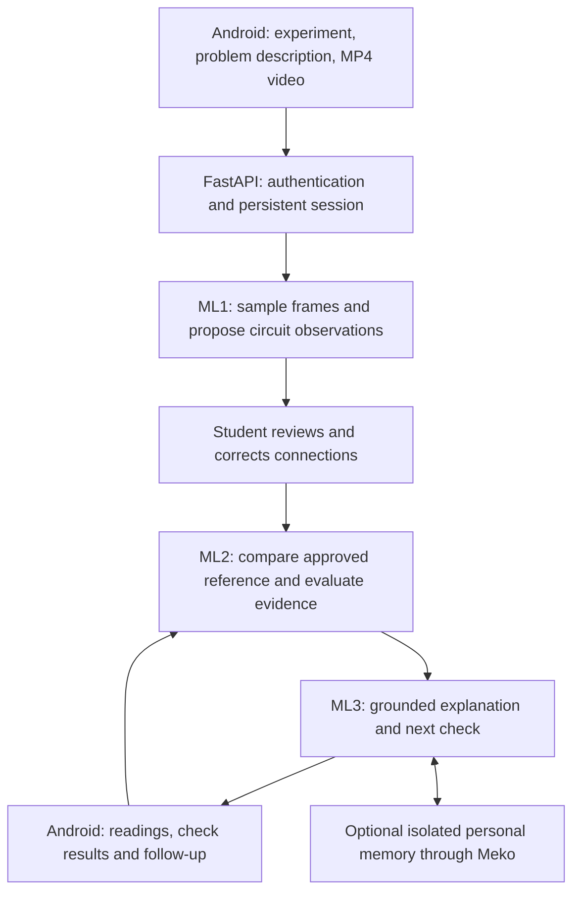

# Git-Good | AI Lab Mentor

An interactive electronics lab assistant that helps students investigate why their circuit is not behaving as expected. Students select an experiment, upload an **MP4 video**, describe the problem, review the extracted connections, and receive evidence-based guidance.

## Problem statement

When an electronics experiment fails, students often struggle to distinguish an incorrect connection, a misunderstanding of expected behaviour, and a possible equipment problem. A wrong reading alone does not identify the cause, and instructors cannot inspect every breadboard immediately.

The challenge is to connect what is physically built with the intended circuit and measured behaviour, while accounting for uncertainty in visual extraction. Incorrect model predictions must not automatically become accusations of incorrect student wiring.

## Proposed solution

Git-Good combines assisted circuit extraction, explicit student review, deterministic circuit reasoning, and a conversational explanation layer.



1. **Capture:** the student selects an experiment and submits a problem description and MP4 video.
2. **Extract and review ML1:** the backend samples up to six video frames and selects one for extraction and review. Optional endpoint detection and Gemini extraction propose observations. Opt-in automatic grid alignment supplies provisional hole centers; printed labels still require review. Unclear connections remain unknown; the student corrects and explicitly confirms the circuit.
3. **Diagnose ML2:** the reasoning core compares the reviewed observation against a server-owned, versioned reference circuit. It checks connectivity and supported component properties, uses ngspice for supported analog predictions, and compares student measurements with expected behaviour.
4. **Explain and iterate ML3:** the mentor layer explains ML2 evidence and requests a useful next check. Optional Qwen generation improves wording; it does not determine circuit facts. New measurements and check results drive the next diagnostic step.
5. **Remember:** when configured, authorized personal history is stored/retrieved through isolated Meko datapacks. SQLite remains the authoritative session and job store. Instructor equipment-review and knowledge-lifecycle services are separate from student observations.

FastAPI owns authentication, session state, durable background jobs, revision checks and orchestration. Android communicates with this single backend, which calls ML1, ML2 and ML3. Changing a circuit invalidates its previous review and diagnosis.

### Current scope

- The architecture supports adding experiments through reference records and adapters. Electrical analysis still requires a supported component model and analysis engine.
- Current reasoning includes connectivity checks, restricted single-frequency analog AC magnitude analysis for R/C/V/ideal-op-amp circuits, and isolated 7400 NAND-as-NOT logic checks.
- A detected part is not automatically a supported electrical model. Arbitrary circuits, diode rectifier simulation, DC/transient analysis and op-amp clipping are not established capabilities of this version.
- The bundled backend catalog contains **synthetic examples**, not an approved real five-experiment catalog. Real use requires instructor-approved records and board/source configuration.
- Automatic extraction is experimental. Manual correction is the fallback; Android must expose the required editing controls. There is no multi-frame circuit fusion or automatic confirmation.
- Probability fields remain uncalibrated/null unless legitimate scores are supplied. Ordinal support is not converted into invented percentages.

## Tech stack

| Layer                    | Technologies and role                                                                                                                       |
| ------------------------ | ------------------------------------------------------------------------------------------------------------------------------------------- |
| Android integration      | Firebase ID tokens and a Retrofit/OkHttp reference client; the complete Android application is maintained separately                        |
| Backend                  | Python 3.11+, FastAPI, Uvicorn, Pydantic validation, multipart uploads                                                                      |
| Video and vision — ML1 | OpenCV headless, NumPy, Pillow; optional Gemini REST extraction and Ultralytics/PyTorch endpoint detection with separately supplied weights |
| Reasoning — ML2        | Python circuit/observation validation, topology comparison, evidence rules, ngspice AC simulation                                           |
| Mentor — ML3           | Grounded explanations, optional Qwen-compatible chat API, outcome and equipment-review services                                             |
| Authentication           | Firebase Admin SDK; server-side ID-token verification with revocation checking                                                              |
| Storage and memory       | SQLite plus private video/frame storage; optional Meko MCP transport for isolated personal memory                                           |
| Packaging and deployment | setuptools, pinned backend runtime dependencies, Docker, Render configuration                                                               |
| Verification             | unittest release checks, JSON Schemas, generated OpenAPI, synthetic pipeline demos                                                          |

## Run on your laptop

Run commands from the repository root. These examples use **Windows PowerShell**. Python 3.12 matches the Docker base image; the package declares Python 3.11 or newer.

### 1. Clone and install

```powershell
git clone https://github.com/nehasiwach802/Git-Good.git
cd Git-Good
git switch backend/android-connection-test

py -3.12 -m venv .venv
.\.venv\Scripts\Activate.ps1
python -m pip install --upgrade pip
python -m pip install -r requirements-backend.txt
python -m pip install -e ".[test]"
```

The integrated backend currently lives on `backend/android-connection-test`. After it is merged into `main`, use `main` instead. The final install command adds the editable package and test dependencies; runtime pins come from `requirements-backend.txt`.

On macOS/Linux, create the environment with `python3 -m venv .venv` and activate it with `source .venv/bin/activate`; use the same pip commands. Translate PowerShell environment settings below to `export NAME=value`.

Install **ngspice** separately for analog simulation and the complete release checks. Put its executable on `PATH`, or set its full path:

```powershell
$env:NGSPICE_EXECUTABLE = "C:/tools/ngspice/bin/ngspice_con.exe"
python -c "from reasoning.spice import find_ngspice; print(find_ngspice())"
```

Use your actual installation path. On Debian/Ubuntu, `sudo apt-get install ngspice` installs the solver. `AUTO_GRID_ENABLED=true` optionally enables unreviewed grid metadata; backend grid/touch operations are available; Android controls still need integration (see [grid handoff](docs/BACKEND_GRID_API.md)). Optional detector dependencies and trained weights are not required for the offline example or manual-review mode; see [deployment configuration](docs/BACKEND_DEPLOYMENT.md).

### 2. Try the complete synthetic flow without credentials

```powershell
python tools/demo_backend.py
Get-Content outputs/backend/synthetic-transcript.json

# Also exercise public grid approval and wire editing:
python tools/demo_backend.py --grid
Get-Content outputs/backend/synthetic-grid-transcript.json
```

The demo creates a synthetic MP4, invokes FastAPI in-process, decodes the video, supplies a known circuit fixture as a **simulated student correction**, and runs ML2 and ML3 through measurements and session closure. It uses a test identity and temporary storage. It does not call Firebase, Gemini, Qwen or product Meko, and does not start a network server.

Expected progress:

```text
session_created: awaiting_image
upload_accepted: extracting
ml1_manual_observation: awaiting_review
ml2_diagnosis_ml3_explanation: awaiting_measurement
measured_truth_table: awaiting_check_result
closed_memory_unavailable: closed
```

This verifies integration with controlled inputs, not automatic extraction accuracy. `memory_unavailable` is expected when personal memory is not configured.

### 3. Start the authenticated backend

Set configuration in the same terminal used to start Uvicorn. These initial settings enable manual circuit review and template explanations:

```powershell
$env:DATA_DIR = "./data"
$env:WORKER_ENABLED = "true"
$env:VIDEO_DEADLINE_SECONDS = "60"
$env:VISION_ENABLED = "false"
$env:QWEN_ENABLED = "false"
$env:FIREBASE_PROJECT_ID = "your-android-firebase-project-id"
$env:GOOGLE_APPLICATION_CREDENTIALS = "C:/secrets/firebase-service-account.json"
$env:DEFAULT_LAB_ID = "local-lab"

python -m backend.preflight
python -m uvicorn backend.app:app --host 127.0.0.1 --port 8000 --workers 1 --no-access-log
```

Replace the Firebase project and credential path with your authorized configuration. The service-account JSON `project_id` must match `FIREBASE_PROJECT_ID`. Keep this file outside Git and Android. If `FIREBASE_SERVICE_ACCOUNT_JSON` is already set, its nonblank value takes precedence over the credential file.

The server can start without Firebase credentials, but authenticated operations will be unavailable and `/ready` will return 503. The offline demo above needs no credentials. `.env.example` documents settings; copying it to `.env` alone does **not** load them into Python.

Open:

- **Health:** <http://127.0.0.1:8000/health> — process liveness.
- **Readiness:** <http://127.0.0.1:8000/ready> — offline configuration/storage checks; 200 or 503 with check results.
- **Interactive API:** <http://127.0.0.1:8000/docs>.
- **OpenAPI:** <http://127.0.0.1:8000/openapi.json>.

Use a real Firebase **ID token** from an authorized test account for session operations. A service-account key is a server credential, not a bearer token. Readiness does not prove live Firebase permissions or model-provider availability; [deployment diagnostics](docs/BACKEND_DEPLOYMENT.md) cover those separately.

To enable actual vision extraction, set `VISION_ENABLED=true`, `GEMINI_API_KEY` and `GEMINI_MODEL`. To enable Qwen wording, set `QWEN_ENABLED=true`, `QWEN_BASE_URL`, `DASHSCOPE_API_KEY` and `QWEN_MODEL`. Supply valid provider settings without committing secrets. Configured inference can contact paid external services.

For personal memory, the operator supplies `MEKO_MCP_URL`, `MEKO_API_TOKEN` and `MEMORY_SCOPES_FILE`. Personal datapacks must be isolated; the team's `gitgood-build` datapack is exclusively for development context and is never product memory.

Real experiments require an approved catalog via `EXPERIMENT_CATALOG_PATH`. Use [backend/catalog.json](backend/catalog.json) as the record-shape example, not evidence of real experiment approval. `python -m backend.preflight --production` additionally requires approved non-simulated experiments. Approval must reflect actual instructor review.

### 4. Connect Android or another API client

The agreed **API 1.1** sequence is:

| Step         | Endpoint and payload                                                                                                                              |
| ------------ | ------------------------------------------------------------------------------------------------------------------------------------------------- |
| Create       | `POST /api/v1/sessions` with JSON `experiment_id`, optional `experiment_version`, and `description`                                               |
| Upload       | `POST /api/v1/sessions/{session_id}/image` with multipart file field **`image` containing MP4**, MIME `video/mp4`, and `expected_session_version` |
| Poll         | `GET /api/v1/sessions/{session_id}`                                                                                                               |
| Interact     | `POST /api/v1/sessions/{session_id}/events` with `{event_id, expected_session_version, type, payload}`                                            |
| Review frame | `GET /api/v1/sessions/{session_id}/image` returns the internally extracted frame                                                                  |
| Complete     | Send the existing `close_session` event; deletion is separate                                                                                     |

Send `Authorization: Bearer <Firebase ID token>` on session operations and UUID `Idempotency-Key` headers for creation/upload. The route/field names `image` and state `awaiting_image` are retained for compatibility: **user uploads are MP4 only, not JPEG/PNG**. Upload limits are 50 MiB and 60 seconds; internal JPEGs are video frames. Old combined image-upload POSTs return 410.

For an Android emulator, use `http://10.0.2.2:8000/` to reach the laptop. A physical device needs a reachable laptop address and Uvicorn bound to `0.0.0.0`; Android's development network configuration must permit local HTTP. Use HTTPS for deployed operation. This checkout supplies a [Retrofit reference](examples/android/VideoSessionApi.kt), not a runnable Android project.

Optional grid/wire events and read-only preview: [grid-review-1](docs/BACKEND_GRID_API.md).

Full payloads and review/version rules: [API contract](docs/BACKEND_API.md) and [Android video handoff](docs/ANDROID_VIDEO_HANDOFF.md).

### 5. Run verification and reasoning examples

```powershell
python tools/run_checks.py
python tools/demo_generalized.py
python -m reasoning examples/rc.json --validate-only
python -m reasoning examples/rc.json
```

The release runner fails if any test fails **or is skipped**; install ngspice before running it. The last verified integrated suite passed **343 tests with zero skips**. Tests use synthetic inputs and mocked external services; live extraction quality, provider authentication and Android-device acceptance require separate testing.

### Repository guide

| Path                                           | Purpose                                                                       |
| ---------------------------------------------- | ----------------------------------------------------------------------------- |
| `backend/`                                     | FastAPI app, authentication, catalog, sessions, persistence and orchestration |
| `labvision/`                                   | ML1 video/frame processing, extraction, detection and handoff                 |
| `reasoning/`                                   | ML2 adapters, reviewed observations, diagnosis and simulation                 |
| `ml3_service.py`, `mentor.py`, `lab_memory.py` | ML3 explanation and personal-memory services                                  |
| `schemas/`, `docs/`                            | API contracts, schemas, architecture and deployment guidance                  |
| `examples/`, `tools/`, `tests/`                | Fixtures, demos and verification                                              |

For hosting, use [Dockerfile.backend](Dockerfile.backend) and the [deployment guide](docs/BACKEND_DEPLOYMENT.md). The current deployment design uses one instance, one Uvicorn worker and persistent `DATA_DIR` storage. Local README commands do not deploy or modify the hosted service.
