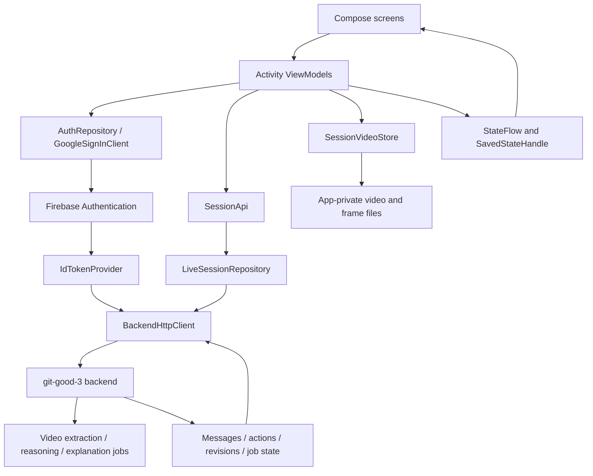
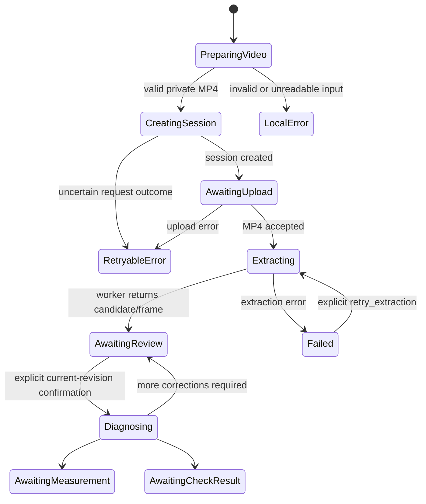

# Circuitly — Complete Implementation Guide

**Document date:** November 1, 2026 · Asia/Kolkata  
**Project:** Git-Good / Circuitly Android  
**Android application ID:** `com.example.gitgood`  
**Active backend:** `https://git-good-3.onrender.com`  
**Deployed API schema version:** `1.1.0`

This document explains the implementation present in this repository: authentication, experiment selection, video capture and upload, session processing, conversation, inline review forms, themes, persistence, retries, and tests. It also identifies backend capabilities that have not been verified.

The current product flow is **video only**. Earlier photo-based instructions and the previous review popup are historical. The backend retains the name `image` in its upload route and multipart field, but Android sends an MP4 video through that contract.

No private keys, service-account JSON contents, passwords, or bearer tokens are included here. Example identifiers and credentials are placeholders unless explicitly identified as public project configuration.

## Contents

1. [Product behavior and implementation status](#1-product-behavior-and-implementation-status)
2. [Architecture](#2-architecture)
3. [Project structure and file responsibilities](#3-project-structure-and-file-responsibilities)
4. [Build configuration and dependencies](#4-build-configuration-and-dependencies)
5. [Application startup and dependency injection](#5-application-startup-and-dependency-injection)
6. [Authentication, password reset, and sign-out](#6-authentication-password-reset-and-sign-out)
7. [Navigation](#7-navigation)
8. [Five-experiment catalog](#8-five-experiment-catalog)
9. [Video-only Home](#9-video-only-home)
10. [Video preparation and validation](#10-video-preparation-and-validation)
11. [Deployed API contract](#11-deployed-api-contract)
12. [Streaming transport and Firebase authorization](#12-streaming-transport-and-firebase-authorization)
13. [Session lifecycle and retries](#13-session-lifecycle-and-retries)
14. [Selected-frame retrieval and display](#14-selected-frame-retrieval-and-display)
15. [Conversation and inline input forms](#15-conversation-and-inline-input-forms)
16. [Light and dark themes](#16-light-and-dark-themes)
17. [State, files, lifecycle, and cleanup](#17-state-files-lifecycle-and-cleanup)
18. [Backend and model boundaries](#18-backend-and-model-boundaries)
19. [Tests and validation evidence](#19-tests-and-validation-evidence)
20. [Setup and device walkthrough](#20-setup-and-device-walkthrough)
21. [Troubleshooting](#21-troubleshooting)
22. [Remaining work and implementation history](#22-remaining-work-and-implementation-history)

## 1. Product behavior and implementation status

Circuitly helps a student review an experimental circuit using a video, a description, and structured evidence. Android collects inputs and presents the backend's messages and review actions. The backend owns extraction, reasoning, explanations, and any ML/provider integration.

The current user journey is:

```text
Welcome / Login / Register
          ↓
    Choose experiment
          ↓
  Upload or record video
          ↓
  Enter circuit description
          ↓
       Continue
          ↓
 Private preparation → create session → stream MP4
          ↓
 Processing and conversation
          ↓
 Selected frame + inline corrections / measurements / confirmation
          ↓
 Exit conversation → Home immediately
```

| Area | Implementation status |
|---|---|
| Email/password authentication | Connected to Firebase Authentication |
| Google sign-in | Connected through Credential Manager and Firebase |
| Forgot Password | Dedicated screen connected to Firebase reset email |
| Home Settings | Top-right Settings opens a light/dark toggle and Sign out; the theme choice persists |
| Five experiment choices | Implemented with explicit availability/demo labels |
| Gallery video selection | Implemented with the Android system picker |
| Camera video recording | Implemented using the external camera app |
| Local playback and removal | Implemented |
| Video validation | MP4, size, duration, and frame dimensions |
| Backend video transfer | Connected to the deployed MP4 contract |
| Session polling and retry | Implemented |
| Selected review frame | Authenticated retrieval and local display |
| Review/input forms | Inline in the chat; no required-actions popup |
| Exit conversation | Immediate local exit; no server close/delete operation |
| Dark/light palette | Consistent teal/slate Material schemes |
| Five complete real experiment analyses | Not established by the Android implementation |
| Live model accuracy and full device end-to-end behavior | Still require validation |

## 2. Architecture

The implementation separates UI, screen state, workflow coordination, transport, and media storage.



The layers have different responsibilities:

- **Compose screens** render state and invoke callbacks. They do not construct authentication headers or interpret assistant text as authoritative actions.
- **ViewModels** coordinate selection, preparation, create/upload sequencing, polling, retries, and account changes.
- **SessionApi** defines the operations required by the live workflow and its test doubles.
- **LiveSessionRepository** serializes the deployed request bodies and constructs multipart video transfer.
- **BackendHttpClient** executes authenticated HTTP requests and handles token refresh, timeouts, account isolation, and bounded responses.
- **SessionVideoStore** owns the private local copy and its validation. It also caches the backend-selected frame.
- **The backend** supplies messages, job state, candidate revisions, actions, and model-derived results.

## 3. Project structure and file responsibilities

All application Kotlin paths below are relative to:

```text
app/src/main/java/com/example/gitgood/
```

### Entry point, navigation, and dependency injection

| File | Responsibility |
|---|---|
| `GitGoodApplication.kt` | Application entry point for Hilt |
| `MainActivity.kt` | Compose theme, auth-driven Navigation3 stack, ViewModel collection, video-to-conversation callbacks, lifecycle and Exit navigation |
| `navigation/ScreenRoute.kt` | Serializable Navigation3 destinations |
| `navigation/AppNavigation.kt` | Register destination and Home picker/camera destination |
| `viewModel/SettingsViewModel.kt` | Exposes the persistent theme preference and change callback |
| `data/preferences/ThemePreferences.kt` | Stores the device-level light/dark choice in private SharedPreferences |
| `di/AuthModule.kt` | Singleton FirebaseAuth provider |
| `di/BackendModule.kt` | ID token provider, HTTP client, live SessionApi binding, video storage binding |
| `di/SessionModule.kt` | Separate older demo-repository binding; not the live screen transport |

### Authentication

| File | Responsibility |
|---|---|
| `data/repository/AuthRepository.kt` | Firebase login, registration, Google credential exchange, reset email, sign-out, auth-state flow |
| `data/repository/GoogleSignInClient.kt` | Credential Manager Google credential request and credential-state clearing |
| `viewModel/LoginScreenViewModel.kt` | Contains the active `LoginViewModel`; handles auth and independent password-reset state |
| `viewModel/SignUpScreenViewModel.kt` | Empty placeholder; registration currently uses LoginViewModel |
| `ui/theme/screen/auth/loading/LoadingScreen.kt` | Welcome/landing screen |
| `ui/theme/screen/auth/login/LoginScreen.kt` | Login form and navigation callbacks |
| `ui/theme/screen/auth/login/LoginUiState.kt` | Login fields, loading/error/message state |
| `ui/theme/screen/auth/SignUp/SignUpScreen.kt` | Registration form |
| `ui/theme/screen/auth/SignUp/SignUpUiState.kt` | Registration form presentation state |
| `ui/theme/screen/auth/forgotpassword/ForgotPasswordScreen.kt` | Password-reset form, success/error/loading presentation, previews, and ForgotPasswordUiState |

Some screen files declare packages that differ from their directory naming, such as the auth login/register screens. Use the actual declarations/imports when moving files or adding references.

### Experiments and Home

| File | Responsibility |
|---|---|
| `data/model/Experiment.kt` | Five product choices, availability enum, exact live/demo resolution |
| `viewModel/ExperimentViewModel.kt` | Catalog retrieval, selection restoration, loading/error state, sign-in recovery |
| `ui/theme/screen/experiment/ExperimentScreen.kt` | Five cards, status labels, selection and Continue availability |
| `viewModel/HomeViewModel.kt` | Selected video, description, and app-owned recording cleanup |
| `ui/theme/screen/home/HomeUiState.kt` | Video URI and description |
| `ui/theme/screen/home/HomeScreen.kt` | Upload video, Record video, preview/removal, description, Continue, Settings |
| `ui/theme/screen/home/HomeSettingsSheet.kt` | Settings bottom sheet with a Dark mode switch and Sign out |
| `ui/theme/screen/home/VideoPreview.kt` | Local VideoView playback and lifecycle cleanup |
| `data/CameraFileProvider.kt` | FileProvider subclass used to share the camera output URI |

### Live backend and conversation

| File | Responsibility |
|---|---|
| `data/backend/BackendModels.kt` | Catalog, session, event, message, and HTTP error models |
| `data/backend/SessionApi.kt` | Live workflow interface |
| `data/backend/LiveSessionRepository.kt` | Deployed JSON routes, streamed MP4 multipart upload, authenticated frame download |
| `data/backend/BackendHttpClient.kt` | JSON/binary HTTP execution and replayable streaming request bodies |
| `data/backend/SessionVideoStore.kt` | Video limits, streamed private preparation, metadata checks, cached frame validation |
| `viewModel/ConversationViewModel.kt` | Video session workflow, snapshots, stable operations, polling, frame loading, immediate Exit |
| `ui/theme/screen/conversation/ConversationUiState.kt` | Message and screen presentation models |
| `ui/theme/screen/conversation/ConversationScreen.kt` | Chat list, inline action slot, processing feedback, message composer, retry and Exit |
| `ui/theme/screen/conversation/ConversationMessageBubble.kt` | User/assistant/system bubbles and selected-frame caption |
| `ui/theme/screen/conversation/SessionActions.kt` | Inline assistant input card driven by server actions |
| `ui/theme/screen/conversation/EvidenceForms.kt` | Component values, mapping, sources, measurements and logic readings |
| `ui/theme/screen/conversation/ConversationScreenPreview.kt` | Preview-only sample states, including dark mode |

### Theme, legacy demo code, and Android resources

| File | Responsibility |
|---|---|
| `ui/theme/Theme.kt` | Complete light/dark Material color schemes and theme selection |
| `ui/theme/Color.kt` | Semantic composable color getters backed by MaterialTheme |
| `ui/theme/Type.kt` | Typography |
| `ui/theme/screen/SplashScreen.kt` | Branded splash presentation |
| `data/model/session/SessionModels.kt` | Earlier proposed/demo session contract |
| `data/repository/SessionRepository.kt` | Earlier demo interface |
| `data/repository/FakeSessionRepository.kt` | In-memory demo responses and workflow scenarios |
| `app/src/main/AndroidManifest.xml` | Internet permission, Hilt application, activity, FileProvider registration |
| `app/src/main/res/xml/camera_file_paths.xml` | App-owned camera cache directories exposed through FileProvider |
| `app/google-services.json` | Firebase Android client configuration; not a Firebase Admin credential |

`SessionImageStore.kt` was removed when the live flow became video-only. Home no longer contains image selection or photo capture callbacks.

## 4. Build configuration and dependencies

Configuration lives in:

- [app/build.gradle.kts](app/build.gradle.kts)
- [build.gradle.kts](build.gradle.kts)
- [gradle/libs.versions.toml](gradle/libs.versions.toml)
- [settings.gradle.kts](settings.gradle.kts)
- [gradle/wrapper/gradle-wrapper.properties](gradle/wrapper/gradle-wrapper.properties)

Observed project versions:

| Component | Version/configuration |
|---|---|
| Gradle wrapper | 9.5.0 |
| Android Gradle Plugin | 9.3.3 |
| Kotlin plugin catalog value | 2.2.10 |
| Compose compiler plugin | `org.jetbrains.kotlin.plugin.compose`, version from Kotlin catalog value |
| Compose BOM | 2026.02.01 |
| Firebase BOM | 34.11.0 |
| Google Services plugin | 4.5.0 |
| Hilt | 2.60.1 |
| KSP | 2.3.9 |
| Navigation3 runtime/UI | 1.1.1 |
| Lifecycle | 2.11.0 |
| Activity Compose | 1.13.0 |
| Coil | 3.3.0 |
| Kotlin serialization JSON/core | 1.9.0 |
| Coroutines Play Services/test | 1.10.2 |
| Compile / target SDK | 37 |
| Minimum SDK | 24 |
| Java source / target compatibility | 11 |

The app applies Android, Google Services, serialization, Hilt, KSP, and Compose plugins. It enables Compose through:

```kotlin
buildFeatures {
    compose = true
}
```

Compose UI, graphics, previews, Material 3, tooling, test dependencies, and Material icons are already included. AGP 9's built-in Kotlin setup is used; an additional Kotlin Android plugin is not applied here. Do not add another plugin or pin older Compose artifacts simply because a generic setup example includes them.

HTTP uses `HttpURLConnection`. Local playback uses Android `VideoView` and `MediaController`. The integration did not add a separate HTTP or video-player dependency.

## 5. Application startup and dependency injection

`GitGoodApplication` enables Hilt. `MainActivity` is an Android entry point and obtains activity-scoped ViewModels using `by viewModels()`.

The primary bindings are:

```text
FirebaseAuth.getInstance()
       ↓
AuthRepository ──→ LoginViewModel
       ↓
IdTokenProvider
       ↓
BackendHttpClient
       ↓
LiveSessionRepository ──implements──→ SessionApi
                                      ↓
                        ExperimentViewModel / ConversationViewModel

AndroidSessionVideoStore ──implements──→ SessionVideoStore
                                      ↓
                              ConversationViewModel
```

The live and fake interfaces are distinct. The presence of `SessionModule` providing `FakeSessionRepository` does not mean the live UI is using fake responses: the active ViewModels inject `SessionApi`, which BackendModule resolves to LiveSessionRepository.

## 6. Authentication, password reset, and sign-out

### Email/password login

1. LoginScreen sends field changes to LoginViewModel.
2. Validate the trimmed email using Android's email pattern.
3. Reject a blank password locally.
4. Set loading state and prevent duplicate auth submissions.
5. Call `AuthRepository.signIn`.
6. Firebase auth-state changes update the eagerly shared `currentUser` flow.
7. MainActivity clears the auth navigation stack and opens experiment selection.

Registration validates the email, matching confirmation, and a password length of at least six characters before calling Firebase account creation. Registration currently shares LoginViewModel instead of using the empty SignUpScreenViewModel placeholder.

### Google sign-in

`GoogleSignInClient`:

1. Reads `R.string.default_web_client_id`, generated through Google Services configuration.
2. Builds `GetSignInWithGoogleOption`.
3. Requests a credential through CredentialManager.
4. Checks the returned custom-credential type.
5. Extracts the Google ID token.

AuthRepository exchanges that Google credential with Firebase using GoogleAuthProvider. Subsequent Circuitly backend requests use a **Firebase ID token from the signed-in Firebase user**, not the original Google credential token.

### Forgot Password

Login's Forgot Password action opens `ScreenRoute.Auth.ForgotPassword` and pre-fills the current email.

The screen uses a separate state object:

```kotlin
data class ForgotPasswordUiState(
    val email: String = "",
    val isLoading: Boolean = false,
    val errorMessage: String? = null,
    val message: String? = null
)
```

LoginViewModel implements opening, email edits, validation, sending, and leaving the screen. The repository calls Firebase's password-reset email API. Success uses a generic message rather than confirming that a particular account exists. Error/loading states are visible, and Back returns to Login.

A generation counter prevents a canceled or previous reset coroutine from updating a later reset screen. Leaving cancels local observation of the request; an email request already accepted by Firebase cannot be undone by navigation.

Actual reset-email delivery still needs a device/account check.

### Sign out

Home's top-right Settings action opens a bottom sheet. Select Sign out inside that sheet. LoginViewModel signs out Firebase and clears Google credential state. The auth-state observer clears authenticated navigation and resets Home, catalog selection, and conversation state. Password text is cleared after the auth operation.

### Firebase configuration boundary

The Android application ID remains `com.example.gitgood`; the configured Firebase project is `circuitly-b1f4c`.

`google-services.json` is client configuration. Firebase Admin service-account credentials belong only on the backend. They must not be copied into Android resources, this document, or session requests.

## 7. Navigation

`ScreenRoute` is a serializable Navigation3 key hierarchy:

```text
ScreenRoute
├── Auth
│   ├── Splash
│   ├── Landing
│   ├── Login
│   ├── ForgotPassword
│   └── Register
├── Experiments
├── Home
└── Conversation
```

MainActivity uses `rememberNavBackStack`, `NavDisplay`, a saveable-state decorator, and a ViewModel-store decorator.

Important transitions:

| Trigger | Result |
|---|---|
| Signed out at startup | Auth landing |
| Signed in while on auth destinations | Experiments |
| Select supported/demo experiment and Continue | Home |
| Select video, enter description, Continue | Start video workflow and open Conversation |
| Forgot Password from Login | Dedicated reset destination |
| Exit or system Back from Conversation | Local exit, then Home |
| Home → Settings → Sign out | Auth landing through the auth observer |

The selected experiment is resolved reactively from the catalog and selected ID. Home is not redirected merely because its catalog is temporarily loading during recreation.

Conversation lifecycle is observed through LifecycleEventObserver. Foreground entry refreshes/resumes work; backgrounding stops polling. The activity-scoped ViewModel retains work across ordinary configuration changes.

## 8. Five-experiment catalog

The five stable product choices are:

| Local selection ID | Display name |
|---|---|
| `not-gate-7400` | NOT Gate Using IC 7400 NAND Gates |
| `ohms-law` | Verification of Ohm’s Law |
| `rc-low-pass-filter` | RC Low-Pass Filter |
| `inverting-op-amp` | Inverting Op-Amp Amplifier |
| `half-wave-rectifier` | Half-Wave Rectifier |

The `Experiment` model separates the local selection ID from the backend's exact identifier and version. It also retains the backend review contract.

Availability values are:

| Availability | Can start? | Display meaning |
|---|---|---|
| AVAILABLE | Yes | Matching approved real workflow |
| DEMO | Yes | Matching synthetic workflow, explicitly labeled |
| UNAVAILABLE | No | Workflow missing or not approved |

All five choices start as unavailable until live resolution.

`resolveExperiments(server)`:

1. Finds exact product-ID matches or case-insensitive trimmed display-name matches.
2. Prefers an approved, nonsimulated match.
3. Otherwise uses the first matching record.
4. If no direct match exists, allows the explicit synthetic demo IDs `nand-not-example` for NOT and `rc-lowpass-example` for RC.
5. Retains the chosen record's actual ID, version, and review contract.
6. Never aliases an unrelated demo to Ohm's Law, the op-amp, or the rectifier.

This does not create or approve backend workflows. The original two-demo catalog explains why earlier screenshots showed only NAND/RC before the five-choice product menu was introduced.

ExperimentViewModel fetches the authenticated catalog, retains selection with SavedStateHandle, and exposes loading/error/recovery state. A 401 after transport handling offers Sign in again and clears usable selection. Older account-generation results cannot overwrite a cleared catalog.

## 9. Video-only Home

HomeUiState contains only:

```kotlin
data class HomeUiState(
    val selectedVideoUri: Uri? = null,
    val description: String = ""
)
```

The screen provides:

- Upload video.
- Record video.
- Selected-video playback and removal.
- Required description, capped at 2,000 Unicode code points.
- Continue, enabled only with a usable experiment, a selected video, valid description, and no recording/sign-out in progress.
- Experiment Change and Settings. Settings contains only a light/dark toggle and Sign out.

There is no image upload button, photo capture button, image preview, or selected image in Home state.

### Video selection

AppNavigation launches `PickVisualMedia` restricted to `VideoOnly`. Cancellation preserves the previous selection. Selecting another video updates HomeViewModel and clears a previous camera error. MP4/size/duration validation occurs during private preparation when Continue is pressed.

### Camera recording

AppNavigation uses `ActivityResultContracts.CaptureVideo` with a FileProvider output URI.

1. Create `cacheDir/videos` if needed.
2. Create an app-owned `.mp4` output file.
3. Retain its pending path with rememberSaveable while the external camera is open.
4. Request a 60-second duration limit and 50 MiB size limit in the camera intent.
5. Launch capture.
6. Accept only a successful result with a nonempty output file.
7. Preview the returned video.

A camera app may ignore requested limits; the later media validation is still required. Canceled or unsuccessful recordings delete the unfinished file. The previously selected video remains available. Missing camera apps and launch/save failures produce inline feedback.

FileProvider is nonexported and grants scoped URI access. Its current authority remains `${applicationId}.camera.files`. `camera_file_paths.xml` includes the video cache directory. Its legacy photo path is retained for compatibility, but no photo input uses it.

### Local preview

VideoPreview uses VideoView with MediaController. It prepares an initial frame without autoplaying audio, exposes playback controls, pauses on lifecycle pause, and stops/releases the view when removed or disposed. Decode failures use inline feedback instead of a platform error dialog.

HomeViewModel tracks an app-owned recording path separately from the selected URI. Only that owned file is deleted during replacement, removal, reset, or ViewModel clearing. Library videos are never deleted.

## 10. Video preparation and validation

Before first-time session creation, AndroidSessionVideoStore copies the chosen URI into `noBackupFilesDir/session-videos` using a 64 KiB buffer.

The private copy provides a stable retry source and avoids depending on a temporary picker grant throughout the backend workflow. It is separate from the original library file or camera cache file.

| Check | Limit/behavior |
|---|---|
| Size | At least 16 bytes and at most 50 MiB |
| Container header | Bytes 4–7 must identify `ftyp` |
| Duration | Greater than zero and at most 60,000 ms |
| Dimensions | Positive width/height; at most 8,500,000 pixels per input frame |
| Suggested capture | 1080p, steady and clearly visible circuit |

MediaMetadataRetriever reads duration and dimensions. The file/header check is not a complete codec validator; the backend decoder remains authoritative.

Preparation is performed on Dispatchers.IO with cancellation checks during copying. Rejected or interrupted preparation removes the incomplete private copy. A first-time invalid video does not create an orphan server session.

SessionVideoStore exposes:

```kotlin
suspend fun prepare(uri: Uri, fileName: String): PreparedSessionVideo
suspend fun file(path: String): File
suspend fun saveFrame(name: String, bytes: ByteArray): String
fun preview(path: String): Uri?
fun remove(path: String)
```

`file(path)` reopens/checks the prepared file for retry. `saveFrame` is for backend-derived review images, not user image uploads.

## 11. Deployed API contract

The active contract snapshot is [docs/deployment/deployed-openapi-v1.1.json](docs/deployment/deployed-openapi-v1.1.json). The older proposed contract in `docs/api-v1` describes the separate demo repository and must not be substituted for the deployed wire format.

### Endpoint table

| Operation | Method/path | Authentication |
|---|---|---|
| Health | GET `/health` | Public |
| Readiness | GET `/ready` | Public |
| Experiment catalog | GET `/api/v1/experiments` | Firebase bearer |
| Backend capabilities | GET `/api/v1/capabilities` | Firebase bearer |
| Create session | POST `/api/v1/sessions` | Firebase bearer + idempotency key |
| Upload MP4 | POST `/api/v1/sessions/{id}/image` | Firebase bearer + idempotency key |
| Read session/poll job state | GET `/api/v1/sessions/{id}` | Firebase bearer |
| Download selected extracted frame | GET `/api/v1/sessions/{id}/image` | Firebase bearer |
| Submit message/action | POST `/api/v1/sessions/{id}/events` | Firebase bearer |

Session IDs are handled as UUIDs by the client.

### Create session

Request:

```http
POST /api/v1/sessions
Authorization: Bearer <FIREBASE_ID_TOKEN>
Idempotency-Key: <CREATE_UUID>
Content-Type: application/json
```

```json
{
  "experiment_id": "<exact ID returned by the catalog>",
  "experiment_version": "<exact version returned by the catalog>",
  "description": "My circuit description"
}
```

Description is required. The app sends the selected backend ID/version, not a guessed local alias. Creation returns a bare session snapshot, normally HTTP 201.

### Upload MP4 — important legacy naming

The current deployment did **not** add a `/video` route. It changed the existing upload contract:

```http
POST /api/v1/sessions/{session_id}/image
```

Multipart fields:

| Field | Value |
|---|---|
| `image` | MP4 file; filename `circuit.mp4`; part MIME `video/mp4` |
| `expected_session_version` | Current snapshot version |

Headers include Firebase Authorization and the upload's stable idempotency UUID. A successful upload returns a bare snapshot with HTTP 202 and processing state.

Example for manual testing, after replacing every placeholder:

```sh
curl -X POST 'https://git-good-3.onrender.com/api/v1/sessions/<SESSION_UUID>/image' \
  -H 'Authorization: Bearer <FIREBASE_ID_TOKEN>' \
  -H 'Idempotency-Key: <UPLOAD_UUID>' \
  -F 'expected_session_version=<SESSION_VERSION>' \
  -F 'image=@/path/to/circuit.mp4;type=video/mp4'
```

The multipart field name does not mean a photo is being uploaded. Android sends only the selected MP4. Do not rename it to `video` or invent a new route without a corresponding server change.

The server also retains `awaiting_image` and `upload_image` names. Android presents these as a video-upload state/action.

### Snapshot model

The Android model reads these fields:

| Field | Role |
|---|---|
| `session_id` | Session identity |
| `session_version` | Concurrency/version guard |
| `state` | Workflow/job state |
| `experiment_id`, `experiment_version` | Exact selected backend workflow |
| `description` | Initial user context |
| `candidate_revision`, `candidate` | Current unreviewed/reviewed circuit proposal |
| `board` | Board configuration for review |
| `messages` | Authoritative server message list |
| `actions` | Structured pending UI requirements |
| `simulated` | Experiment provenance |
| `job_id`, `error` | Processing identity/failure information |
| `image` | Selected extracted-frame receipt, nullable during processing |
| `ml1` | Extraction/media metadata, including selected frame information |

Kotlin serialization ignores unknown response fields to tolerate additive server changes. This is not a license to ignore incompatible route/payload semantics.

Responses are not wrapped in the older `{request_id, data}` demo envelope.

### Event format

```json
{
  "event_id": "00000000-0000-4000-8000-000000000001",
  "expected_session_version": 8,
  "type": "confirm_candidate",
  "payload": {
    "candidate_revision": 3,
    "acknowledgement": "reviewed_all_connections_and_board"
  }
}
```

Candidate revision belongs **inside payload**. An event ID identifies one operation and remains unchanged for its retry.

| Event type | Payload used by Android |
|---|---|
| `message` | `text`, nonblank and up to 2,000 characters |
| `correct_endpoint` | `candidate_revision`, `target`, and `hole` or `external_terminal` |
| `replace_candidate` | `candidate_revision`, updated `candidate` |
| `confirm_candidate` | `candidate_revision`, exact acknowledgement string |
| `set_correspondence` | `component_map`, `port_map` |
| `source_settings` | `candidate_revision`, per-source `dc` and `ac` values |
| `measurements` | `candidate_revision`, typed measurement rows |
| `check_result` | `check_id`, observation text |
| `retry_extraction` | Empty payload |

The backend also supports a close-session event, but the app's Exit action does not use it. Permanent deletion is likewise not an Exit operation.

## 12. Streaming transport and Firebase authorization

### Token provider

BackendModule obtains the Firebase user's ID token using `getIdToken(forceRefresh)`. The current user's UID is available for account-isolation checks.

For each HTTP operation:

1. Require a signed-in UID.
2. Obtain the Firebase ID token.
3. Check that the account is still the same.
4. Send `Authorization: Bearer <token>`.
5. If the server returns 401, refresh once and replay the same request.
6. Reject a response if the account changed while it was in flight.

A second 401 is returned to the UI. Catalog errors then offer Sign in again; the app does not disable backend authentication or substitute an Admin credential.

### Connection behavior

BackendHttpClient:

- Uses the configured HTTPS base URL.
- Disables automatic redirects.
- Uses 30-second connection and 90-second read timeouts.
- Caps response bodies at 8 MiB.
- Uses JSON Accept headers for JSON calls and a binary-compatible Accept header for frame retrieval.
- Parses structured/string `detail` errors and provides status-specific fallback messages.
- Does not automatically retry network/server failures for mutations.

### MP4 streaming

LiveSessionRepository constructs a replayable StreamingRequestBody:

```text
multipart prefix
    + file stream copied through a 64 KiB buffer
    + multipart suffix
```

It calculates and sets the full Content-Length before transfer. It checks cancellation between chunks and verifies the file's length remains consistent. The file is reopened for a token-refresh replay.

The multipart boundary remains part of that request object during an auth replay. A later explicit repository retry can use a new boundary, while retaining the operation's upload key, video content, and expected session version.

The 50 MiB video is never assembled into a single ByteArray. JSON responses and selected-frame downloads are separately bounded.

## 13. Session lifecycle and retries

### Start workflow

ConversationViewModel.startVideo performs:

1. Reset local account-specific state if the signed-in account changed.
2. Validate description and experiment availability.
3. Reject duplicate active starts.
4. Clean prior private video/frame copies from the previous completed local workflow.
5. Save experiment name/review contract and create request.
6. Generate distinct create/upload UUIDs.
7. Prepare and validate a private MP4 copy.
8. Save the prepared path.
9. Create the session.
10. Save/apply its snapshot.
11. Upload the MP4 using the snapshot version.
12. Save/apply the processing snapshot and begin foreground polling.

### State mapping



Other terminal/outcome states are accepted from the server. Busy states are `extracting`, `diagnosing`, and `completing`; closed states are `closed` and `completed`.

### Operation identity

| Saved value | Why it exists |
|---|---|
| `createRequest` | Reconstruct the same initial request |
| `createKey` | Prevent duplicate sessions after an uncertain create response |
| `uploadKey` | Prevent duplicate accepted video attachments |
| `uploadVersion` | Preserve the original expected version for upload retries |
| `creationStarted` | Distinguish a purely local failure from an uncertain server create |
| `pendingEvent` | Retain the exact event ID, type, version, and payload |
| `snapshot` | Restore the last known session state |
| `owner` | Attribute state to the signed-in account |
| `videoPath`, `framePath`, `frameHash` | Stable local retry/preview and cleanup identities |
| `draft`, `name`, `contract` | Restore chat context and presentation |

A missing/invalid prepared video before the first request does not create a session. If a create was already attempted and its result is uncertain, its original key can be reconciled even when the local media is later missing.

### Polling

While foregrounded and busy, the ViewModel polls approximately every two seconds. Polling pauses when backgrounded and resumes/refreshes on foreground entry. It avoids overlapping explicit operations. Polling failure is shown with Retry rather than silently claiming completion.

Snapshots replace the server message list. They are not appended wholesale, so polling does not duplicate messages. An older version cannot replace a newer snapshot from the same session.

### Errors and conflicts

| Situation | Client behavior |
|---|---|
| Network/server error during create/upload | Retain operation identity for explicit retry |
| Event error with uncertain outcome | Keep exact pending event and block new mutations until resolved |
| 401 | One forced token refresh, then visible failure if still rejected |
| 409 | Attempt snapshot refresh; discard stale event; require another explicit review |
| Upload conflict with awaiting-upload state | Refresh upload version/key for the next explicit attempt |
| Definite validation/permission/not-found rejection | Clear invalid pending operation as appropriate and show error |
| Backend extraction failed | Show error and structured retry-extraction action |
| Account changed | Cancel local work and discard prior-account state/results |

No retry may silently confirm newer wiring using an earlier revision's acknowledgement.

### Immediate Exit

Exit is deliberately local:

- Increment the workflow generation.
- Cancel local operation, polling, and frame-loading jobs.
- Clear the active snapshot, pending requests/events, and review state.
- Retain only owner/media cleanup paths as needed.
- Set the UI's exited flag.
- MainActivity removes Conversation and reveals Home.

Exit is available while sending or processing. It does not call close_session, DELETE, or another model request. Home retains its selected video and description. A request already accepted by the backend may continue there.

## 14. Selected-frame retrieval and display

The backend's selected frame is represented by `snapshot.image` and media metadata inside `ml1`.

The client:

1. Reads the receipt's SHA-256 identifier.
2. Waits for a foreground, nonbusy snapshot.
3. Avoids downloading an already cached frame identity.
4. Authenticates `GET /sessions/{id}/image` with the same Firebase token boundary.
5. Validates the downloaded bytes as bounded JPEG/PNG data with positive dimensions no larger than 2,000 pixels per edge.
6. Saves the frame privately and exposes a local URI.
7. Discards a late result if the account/workflow/session/frame identity changed.

The receipt hash is used for identity/cache association; the file is not a public or presigned URL.

The frame ID and timestamp come from `ml1.media.selected_frame_id` and its matching frame metadata. A caption such as “Review frame F2 at 2.5s” accompanies it.

The first user message displays the derived frame. If the server supplied no initial user message, Android adds a local presentation item containing the description and video-attachment notice. This is presentation, not a fabricated backend diagnosis.

A derived review image is not a user image upload. The uploaded evidence remains the original MP4. The current chat displays the selected frame rather than embedding a second full video player in every message.

## 15. Conversation and inline input forms

### Chat state and messages

ConversationUiState tracks:

- Experiment name and server-derived messages.
- Draft text and sending/error state.
- Synthetic/demo notice.
- Human-readable workflow status.
- Whether messaging is currently allowed.
- Exit state and processing state.
- Selected review-frame URI and caption.

ConversationMessageUi contains a stable ID, sender, text, optional frame URI, and optional attachment caption. User bubbles align right; assistant/system bubbles align left. The server message role determines presentation.

The message composer allows up to 2,000 Unicode code points. Sending serializes a typed `message` event; it does not infer circuit mutations from text.

### Inline actions replace the popup

The former Review required actions button and AlertDialog are removed.

Current action rendering is:

```text
Latest chat messages
        ↓
Circuitly inline input card
  selected frame / pending requirements
  correction and evidence fields
  explicit submit/confirm controls
        ↓
Processing feedback, when applicable
```

ConversationScreen inserts the action card as an item inside its LazyColumn. It scrolls with the conversation. There is no nested scrolling popup and no Done/close-panel step.

`actionsKey` lets the screen respond to new pending actions or candidate revisions without requiring a separate button. Optional circuit details expand inline, while input fields are already visible.

### Input preservation

SessionActions keys its content by session, candidate revision, action type, and check identity. Message-only snapshot updates do not discard unfinished fields. A new candidate revision/check resets the corresponding form. Inputs and submit controls are disabled during submission.

### Supported forms

| Form | What the user enters | Event |
|---|---|---|
| Endpoint correction | Component.pin, wire endpoint, or port ID; board hole or external terminal | `correct_endpoint` |
| Resistor/capacitor value | Positive SI value in ohms/farads | `replace_candidate` |
| Component correspondence | Observed component → reference label, or explicitly extra | `set_correspondence` |
| Port correspondence | Observed port → declared reference port | `set_correspondence` |
| Source settings | Finite DC and AC values for configured sources | `source_settings` |
| Analog AC reading | Nonnegative voltage magnitude for a declared probe/frequency | `measurements` |
| 7400 observation | Binary input/output levels | `measurements` |
| Check observation | Text associated with the current check ID | `check_result` |
| Extraction retry | Explicit user request | `retry_extraction` |
| Candidate confirmation | Checkbox acknowledging reviewed connections/board | `confirm_candidate` |

Analog measurements use `unit: V` and `convention: ac_magnitude`. Logic observations use integer 0/1 fields. The forms use catalog metadata instead of inventing probes, component identities, or source labels.

### Confirmation safeguards

- Show the displayed candidate revision.
- Require the user to compare connections, parts, and board layout with the selected frame.
- Do not enable a required frame's confirmation while that frame is unavailable.
- Require the explicit acknowledgement checkbox.
- Send the current candidate revision inside payload.
- Let backend validation reject unresolved endpoints, missing values, or stale state.

Unknown actions are presented as requiring additional app support. The client does not derive required fields/buttons by parsing assistant prose or make instructor-authorization claims for the user.

## 16. Light and dark themes

The previous problem was a mixture of fixed light surfaces and Material controls following the device's dark/dynamic scheme. Theme.kt and semantic color getters now keep the screens consistent.

| Role | Dark | Light |
|---|---|---|
| Background | `#0C151D` | `#EAF0F4` |
| Surface | `#16232E` | `#F8FAFC` |
| Primary body text | `#E5EDF3` | `#172B38` |
| Primary accent | `#69DDB8` | `#006B53` |
| Primary container | `#16483C` | `#CDEFE2` |

On first use, the app follows the system theme. Home → Settings provides a Dark mode switch: on selects dark and off selects light. The choice applies immediately across app screens, is saved in `circuitly_settings` SharedPreferences under `dark_theme`, and survives restarts and sign-out. SettingsViewModel exposes a nullable preference: null means no choice has yet been saved. MainActivity resolves the effective theme before calling GitGoodTheme and updates system-bar icon styles for that choice. Wallpaper-derived dynamic colors remain disabled by default; GitGoodTheme retains an opt-in parameter.

Semantic getters include BackgroundColor, SurfaceColor, PrimaryTextColor, SecondaryTextColor, PrimaryGreen, OnPrimaryColor, LightGreen, and BorderColor. Their legacy names are retained, but values come from MaterialTheme instead of fixed light hex values.

Auth, splash, experiments, Home, message bubbles, input fields and inline action cards use the same palette. Preview-only states cover relevant light/dark screens.

ThemeContrastTest checks representative body, background, secondary, accent, primary-button and user-message pairs against a minimum 4.5:1 contrast ratio. This test is evidence for those defined color pairs, not a full accessibility audit of every state on every device.

## 17. State, files, lifecycle, and cleanup

| Data | Owner/lifetime |
|---|---|
| Firebase user session | Firebase SDK |
| Login/reset form state | LoginViewModel; passwords are not placed in SavedStateHandle |
| Experiment selection | ExperimentViewModel and SavedStateHandle |
| Light/dark choice | ThemePreferences, private SharedPreferences; device-level and retained after sign-out |
| Home video/description | HomeViewModel across ordinary activity recreation |
| Pending camera output | rememberSaveable path while camera is open |
| Camera original | App cache; HomeViewModel tracks ownership |
| Prepared retry video | App-private noBackupFilesDir/session-videos |
| Extracted review frame | App-private noBackupFilesDir/session-videos |
| Session snapshot and pending operation identities | ConversationViewModel and SavedStateHandle |
| Original server video and extraction assets | Backend-controlled storage/retention |

Playback cleanup is tied to UI/lifecycle disposal. Polling is tied to conversation foreground state. Generations/account checks prevent stale work from replacing a newer user's screen state.

The Home URI/description are not a full durable media draft database. SavedStateHandle supports ordinary Android restoration, not a guaranteed offline outbox after force-stop, cleared app data, or every fresh launch. There is no server session-history browser or resume-by-ID UI.

Exit and sign-out have different meanings: Exit leaves the current conversation locally; sign-out clears authentication and account-specific state. Neither is implemented as permanent server session deletion.

## 18. Backend and model boundaries

### What was integrated versus what was inspected

This repository's changes implement the Android client. Backend source was inspected from the GitHub branch `backend/android-connection-test`, and the deployed OpenAPI/health/readiness endpoints were checked. Backend deployment, credentials, model configuration, and server data were not modified by this Android work.

The inspected video pipeline stages the MP4, runs bounded decoding/frame selection, and sends the selected frame to extraction when vision is enabled. Android does not perform frame extraction or merge multiple views into a guessed circuit.

The backend owns ML1 extraction, ML2 reasoning, ML3 explanation, any ngspice execution, and optional model/memory services. A successful video upload or “extracting” message does not prove those components produced an accurate circuit diagnosis.

### Last recorded readiness observation

The observed git-good-3 response included:

```json
{
  "status": "ready",
  "checks": {
    "firebase_project": true,
    "firebase_credentials": true,
    "ngspice": true,
    "worker": true,
    "video_decoder": true,
    "writable_storage": true,
    "catalog": true
  },
  "firebase_credential_error": null,
  "firebase_permissions_verified": false,
  "approved_real_experiments": 0,
  "live_providers_verified": false
}
```

This is a recorded observation, not a continuously monitored guarantee. It establishes that the public readiness checks passed at that time, while explicitly not establishing live provider verification or approved real experiments.

### Free-form conversational limitation

The inspected backend message branch returns an existing explanation if present, otherwise a fixed instruction to use review controls. It does not generate a fresh model answer to every question. Moving review forms into the chat changes the UI, not that backend behavior.

Video results can include manual/unresolved/calibration requirements. Android shows server requirements; it does not manufacture calibration events or expose nonexistent endpoints. Completing such workflows may require a backend contract extension and corresponding UI.

### Firebase troubleshooting history

An earlier device screenshot showed HTTP 401 `invalid_token`. The inspected auth handler originally collapsed credential initialization and verification failures into the same message, so the exact original cause was not proven from that response alone.

Recommendations were to distinguish invalid user tokens from server configuration/permission failures, validate credentials beyond environment-variable presence, and log safe exception types. The provided diagnostic at `docs/deployment/check_firebase_auth.py` can check credentials/OAuth/user-read permissions in the backend environment without printing private keys, tokens, or user records.

A service-account key was shared during development. The user was instructed to revoke/replace it; completion was not verified. Do not copy old credential attachments or raw chat into shared documentation or memory.

## 19. Tests and validation evidence

The latest completed build/test command was:

```sh
./gradlew :app:assembleDebug :app:testDebugUnitTest --console=plain
```

Result: debug APK build successful, **59 unit tests, zero failures/errors** in the observed reports.

| Suite | Tests | Coverage focus |
|---|---:|---|
| ExampleUnitTest | 1 | Baseline project test |
| LiveSessionRepositoryTest | 14 | Authenticated catalog/session routes, bare snapshots, MP4 multipart fields/MIME/body length, image/size rejection, token replay, binary frame GET, conflicts/account isolation |
| VideoUploadLimitsTest | 4 | Valid duration/dimensions and rejected long/oversized-frame/audio-only metadata |
| ExperimentCatalogTest | 5 | Five visible choices, explicit demos, exact IDs/versions, approved preference and missing-workflow behavior |
| FakeSessionRepositoryTest | 17 | Separate legacy/demo state machine and idempotency scenarios |
| ThemeContrastTest | 2 | Representative light/dark text color contrast |
| ConversationViewModelTest | 13 | No-orphan validation, stable create/upload/event retries, frame metadata, stale revisions, account reset, monotonic snapshots and immediate Exit |
| ExperimentViewModelTest | 3 | Auth recovery, successful retry and network error handling |
| **Total** | **59** | |

Transport tests use a local HTTP server; workflow tests use fakes. They do not upload a real user's clip to production or certify model accuracy. Camera apps, codecs, physical-device playback and reset-email delivery require device checks.

This document was generated from current source and existing successful reports. No additional application code changes were required for documentation generation.

## 20. Setup and device walkthrough

### Local setup

1. Open this repository in Android Studio with a compatible SDK/toolchain.
2. Ensure Android SDK 37 and the configured Gradle/JDK setup are available.
3. Place the matching Firebase Android client configuration at `app/google-services.json`.
4. Keep the Android package `com.example.gitgood` registered in the matching Firebase project.
5. Ensure the intended Firebase auth providers and the Android signing fingerprints are configured for the installed build. The exact fingerprints are not recorded in this guide.
6. Sync Gradle and build the app.
7. Confirm BackendHttpClient's base URL matches the intended deployed contract before changing it.

### Device acceptance checklist

1. Register or log in with email/password.
2. Log out and test Google sign-in.
3. Open Forgot Password, check invalid email feedback, request a reset, and verify delivery on an account you control.
4. Confirm all five experiment cards are visible with honest status labels.
5. Select an available/demo workflow and open Home.
6. Select a valid MP4; play/pause it and remove/replace it.
7. Record a clip, confirm it, and preview it.
8. Cancel a second recording and confirm the previous clip remains selected.
9. Try a non-MP4, a clip over 60 seconds, and a clip over 50 MiB; confirm preparation rejects unsupported input before a new session is created.
10. Add a description and Continue.
11. Confirm upload, processing status, selected-frame display and inline inputs.
12. Enter a correction/value/measurement through its structured form.
13. Confirm only the displayed reviewed revision; check that stale responses require a new review.
14. Interrupt connectivity during upload and retry; check that operation identity is preserved.
15. Exit during processing; confirm immediate Home navigation without a server close request.
16. Open Home → Settings. Toggle Dark mode on/off, check other screens and system-bar icons, restart the app, and verify the chosen theme persists. Also check keyboard/scrolling while filling inline inputs.
17. Open Settings → Sign out and confirm authenticated state is cleared while the saved theme remains.
18. Separately evaluate model output against known circuits; transport success alone is not a quality test.

The debug APK is generated under `app/build/outputs/apk/debug/app-debug.apk` after assembleDebug.

## 21. Troubleshooting

| Symptom | What to inspect |
|---|---|
| Android Studio shows errors but Gradle compiles | Gradle sync/indexing and the exact first IDE diagnostic; do not blindly rewrite Compose dependencies |
| “Valid Firebase ID token required” | Firebase project alignment, current Firebase user token, refreshed 401 outcome, backend exception type and Auth permissions |
| Only two choices can start | Catalog contains two synthetic workflows; the other cards need published/approved backend support |
| MP4 upload returns 415 | Part MIME must be video/mp4 and field must be image; validate the actual file/container |
| Upload returns 413 | Check file and multipart/server size limits |
| Upload returns 409 | Refresh snapshot; do not reuse an old version as a new wiring confirmation |
| Video remains in failed state | Read returned error and retry extraction explicitly or choose a supported clip; inspect backend decoder/provider configuration |
| Selected frame does not load | Authenticated frame endpoint, returned image receipt, local validation and retry feedback |
| Chat keeps asking for review | Structured review may be pending; the backend message handler is not necessarily a live free-form conversational model |
| Model reports unresolved/calibration input | Follow published structured actions; missing API support must be added on the backend rather than guessed in Android |
| No camera app or empty recording | Camera intent support, FileProvider output path, cancellation/save result |
| Meko context not found remotely | Previous upload attempt failed with 401; the local handoff is not proof of a remote write |

A `.json` filename or an environment variable's presence does not independently establish valid credentials. Backend diagnostic output should report safe exception classes rather than exposing secrets.

## 22. Remaining work and implementation history

### Remaining work

- Perform a signed-in physical-device video-to-backend-to-reviewed-diagnosis run.
- Verify actual live vision/explanation provider configuration and evaluate extraction/diagnostic quality.
- Complete and publish missing real experiment workflows with valid reference/analysis metadata.
- Add backend support and explicit Android controls for any required calibration/frame-selection actions not in the present API.
- Add true per-message conversational generation if the product requires it; preserve structured action/version safeguards.
- Decide server video/session retention, historical session listing and durable resume/outbox behavior before implementing them.
- Test camera/codec differences, upload timeouts, accessibility, and small-screen keyboard behavior on devices.
- Review production/release build, signing, deployment and monitoring separately from the debug build evidence recorded here.

### Major implementation changes, in order

| Stage | Result |
|---|---|
| Firebase/auth setup | Matching Android package configuration, Google sign-in, Hilt, Internet access and auth navigation |
| Initial Home | Photo upload/camera, preview and description |
| Experiment selection | Five requested experiment names before Home |
| Early dummy API work | Integrated then explicitly reverted at the user's request |
| Fake contract/repository | Separate demo state machine and documentation/tests |
| Real API v1.1 | Firebase-authenticated catalog, sessions, upload, polling, messages and structured actions |
| Auth diagnosis | Distinguished runtime Firebase 401 from Compose setup; added recovery/diagnostic guidance |
| Theme overhaul | Consistent slate/teal light and dark schemes |
| Catalog availability | Five product cards with explicit synthetic/missing workflow labels |
| Exit change | Immediate local Home navigation with no close/delete request |
| Auth UX additions | Dedicated Forgot Password screen and Home Sign out |
| Home Settings | Replaced the direct Sign out action with a Settings sheet containing a persistent light/dark toggle and Sign out |
| Initial video UI | Gallery video preview added alongside photos |
| Video-only change | Photo inputs/state/submission removed; camera recording added |
| git-good-3 integration | MP4-only legacy-named endpoint, streamed upload, limits, polling and selected-frame review |
| Inline review change | Required-actions button/popup replaced by forms inside the chat |

### Related documentation

- [Current live integration guide](docs/deployment/android-live-integration.md)
- [Deployed v1.1 OpenAPI snapshot](docs/deployment/deployed-openapi-v1.1.json)
- [Credential-free project handoff](docs/handoff/circuitly-project-context.md)
- [Backend Firebase diagnostic](docs/deployment/check_firebase_auth.py)
- [Older proposed contract](docs/api-v1/contract.md)
- [Older demo repository guide](docs/api-v1/fake-repository.md)
- [Conversation UI walkthrough](docs/ui/conversation-screen-walkthrough.md)

Older guides/PDFs may describe superseded photo inputs, popup review, or close-on-exit behavior. Current source and this document's current-flow sections take precedence.

Meko context transfer was attempted through the configured MCP endpoint and rejected with HTTP 401. No remote persistence was confirmed. The handoff remains a local, credential-free document; a later Meko upload needs reconnection and read-back verification.

## Touch-based wire review — November 1, 2026

The conversation includes a local touch review preview: native-pixel zoom/pan,
explicit two-tap wire pairing, endpoint edits, delete, cancel and undo. Frame and
board identity checks guard provisional grid overlays and optional detector boxes.
Printed corner labels preview reversed rows and swapped strips. Unknown endpoints
remain unknown; no wire pairing is inferred from model boxes.

Drafts bind to account/session/frame/board/revision/grid metadata and clear when
that identity changes. They remain in memory only. Unsent wire edits block final
confirmation. Existing manual endpoint corrections remain available.

Grid approval and wire-pair saving remain visibly disabled because the inspected
public API publishes neither operation. No invented backend events were added.
ML2 must publish authenticated typed approval/mutation operations, idempotency and
version guards, accepted snapshots, and conflict handling before saving can work.
Raw ML1 reviewed or labels_confirmed flags do not grant approval. A Wire Connections
catalog entry also requires actual backend catalog support.

New files: data/model/wirereview/WireReviewModels.kt, WireReviewParser.kt,
ui/theme/screen/conversation/WireReviewCanvas.kt and WireReviewPanel.kt.
Integration: ConversationUiState.kt, ConversationViewModel.kt, SessionActions.kt,
and MainActivity.kt. Regression coverage: WireReviewTest.kt.

Physical-device gesture checks with matching ML grid responses remain necessary;
unit tests do not establish model accuracy.
